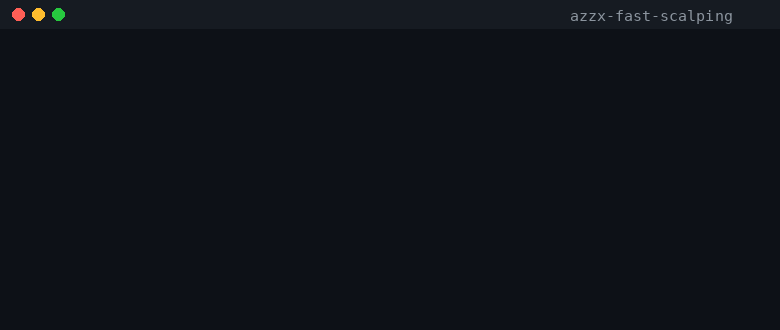

# azzx-fast-scalping

Tools scalping cepat untuk **Binance futures** dengan analisis multi-timeframe (1m/5m/15m): bias arah diambil dari timeframe 15m (EMA21 + MACD histogram), lalu entry dipicu oleh persilangan EMA(9/21) di 1m/5m dengan filter ATR, volume, dan spread.

100% Python stdlib — tanpa dependensi eksternal.



## Instalasi

```bash
python3 -m venv venv
source venv/bin/activate
pip install -r requirements.txt   # stdlib only, tidak menginstal apa pun
```

## Multi-exchange

Didukung: **binance** (default), **okx**, **bybit**, **bitget**.

```bash
python -m scalping BTCUSDT -e bybit --margin 50 --lev 10 --mode paper
python -m scalping ETHUSDT -e okx --margin 100 --lev 5 testnet
```

API key via environment (tidak pernah di argumen / file):

| Exchange | Key env |
|---|---|
| binance | `BINANCE_TESTNET_KEY/SECRET`, `BINANCE_LIVE_KEY/SECRET` |
| okx | `OKX_KEY`, `OKX_SECRET`, `OKX_PASSPHRASE` (+`OKX_DEMO=1` untuk demo) |
| bybit | `BYBIT_KEY`, `BYBIT_SECRET` |
| bitget | `BITGET_KEY`, `BITGET_SECRET`, `BITGET_PASSPHRASE` |

Tanpa `-e`, default = binance.

## Cara menjalankan

Entry point: `python -m scalping.run` (rencana; modul run belum tersedia).

### Mode `paper` (default, aman)

Tidak ada order sungguhan — sinyal hanya dicatat/log.

```bash
python -m scalping.run --mode paper --symbol BTCUSDT
```

### Mode `testnet`

Terhubung ke Binance Futures testnet. Butuh API key testnet (bukan key akun asli).

```bash
export BINANCE_TESTNET_API_KEY=...
export BINANCE_TESTNET_API_SECRET=...
python -m scalping.run --mode testnet --symbol BTCUSDT
```

### Mode `live`

Uang sungguhan. Jalankan hanya setelah paper & testnet terbukti stabil.

```bash
export BINANCE_API_KEY=...
export BINANCE_API_SECRET=...
python -m scalping.run --mode live --symbol BTCUSDT
```

## ⚠️ Peringatan risiko — baca dulu

- **Scalping di timeframe 1 menit sangat berisiko.** Noise harga tinggi, sinyal palsu sering muncul, dan keputusan harus diambil dalam hitungan detik.
- **Fee menggerogoti profit.** Dengan target sekecil 1.5× ATR, komisi taker + slippage bisa menghapus edge strategi — backtest WAJIB memasukkan fee dan slippage.
- **Hasil backtest bukan jaminan profit di masa depan.** Kondisi market berubah; strategi yang bagus di data historis bisa gagal total saat live.
- **Mulai dari mode paper**, lanjut ke testnet, dan hanya ke live bila keduanya konsisten.
- **Jangan pakai uang yang tidak siap hilang.** Jangan trading dengan dana kebutuhan pokok, dan jangan pakai leverage berlebihan.

## Parameter utama

| Parameter | Nilai default | Keterangan |
|---|---|---|
| EMA fast / slow | 9 / 21 | Trigger cross di 1m & 5m |
| Bias timeframe | 15m | EMA21 + MACD histogram |
| Filter | ATR + volume + spread | Entry hanya bila semua lolos |
| Take profit | 1.5 × ATR | Target profit per trade |
| Stop loss | 1.0 × ATR | Batas rugi per trade |
| Time stop | 15 menit | Tutup paksa bila trade berlarut |
| Fee & slippage | wajib di backtest | Tanpa ini hasil backtest menipu |

## Lisensi

MIT — lihat file `LICENSE`.
